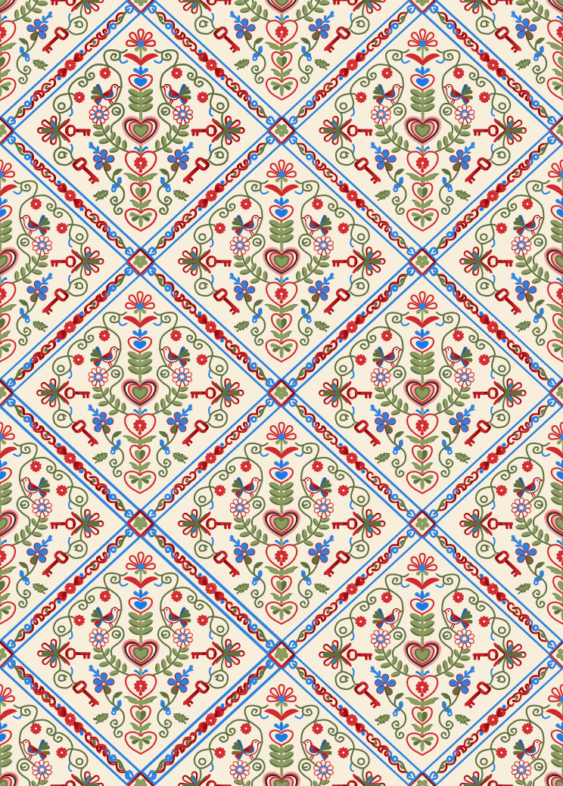

# Two of Hearts — Portuguese Folk Art

A vector illustration project inspired by **Lenços de Namorados**, the traditional love handkerchiefs from the Minho region of Portugal.

This project explores how Portuguese cultural heritage and romantic symbolism can be reinterpreted through contemporary vector illustration.

## Project Overview

The **Two of Hearts (2♥)** symbolizes love, connection, and unity.

The front features two stylized birds beneath a central heart, surrounded by floral details inspired by traditional Portuguese embroidery. The back features a continuous decorative pattern that shares the same visual language, creating a coherent design across both sides of the card.

The color palette combines cream, red, pink, green, and blue.

## Final Design

### Front

### Back

## Design Process

### 1. Research and Moodboard

The initial phase involved collecting visual references and exploring the colors, symbols, and decorative patterns associated with Lenços de Namorados.

### 2. AI-Generated Concepts

I used an AI image generation tool to explore an initial concept for the front and back of the card. These images served as visual references for developing the final illustration.

**Original prompt:**

> 2 of Hearts playing card set, front and back, traditional Portuguese folk art style, Lenços de Namorados, symmetrical vector of two birds kissing, floral embroidery, matching back pattern, cream and red palette

#### AI-Generated Front

#### AI-Generated Back

### 3. Vector Illustration

Using the moodboard and AI-generated concepts as references, I developed my own vector illustration in Affinity. The final design brings together decorative details, a coordinated color palette, and a consistent visual identity for both sides of the card.

## Tools and Specifications

- **Software:** Affinity
- **Project type:** Vector illustration
- **Card:** Two of Hearts (2♥)
- **Dimensions:** 63 × 88 mm
- **Front:** Two stylized birds, a central heart, and floral ornaments
- **Back:** Continuous folk-inspired decorative pattern
- **Color palette:** Cream, red, pink, green, and blue
- **Editable source file:** [two-of-hearts.af](artwork/two-of-hearts.af)

## Cultural Inspiration

Lenços de Namorados are a traditional form of embroidered folk art associated with the Minho region of Portugal. Their hearts, birds, flowers, and romantic symbolism inspired the visual direction of this project.

By reinterpreting these traditional motifs in a playing card, this project explores how Portuguese folk art can inspire contemporary graphic design.

## Academic Context

- **Course:** Software Development — CTeSP, 2nd Year
- **Course unit:** Authoring Tools (*Ferramentas de Autoria*)
- **Assignment:** Practical Assignment 1 — Vector Illustration
- **Project brief:** *A Dar Cartas*
- **Software:** Affinity
- **Submission dates:** 27 October 2026 (EST) and 29 October 2026 (OAZ)

---

*An academic project exploring Portuguese folk art, romantic symbolism, and vector illustration.*
