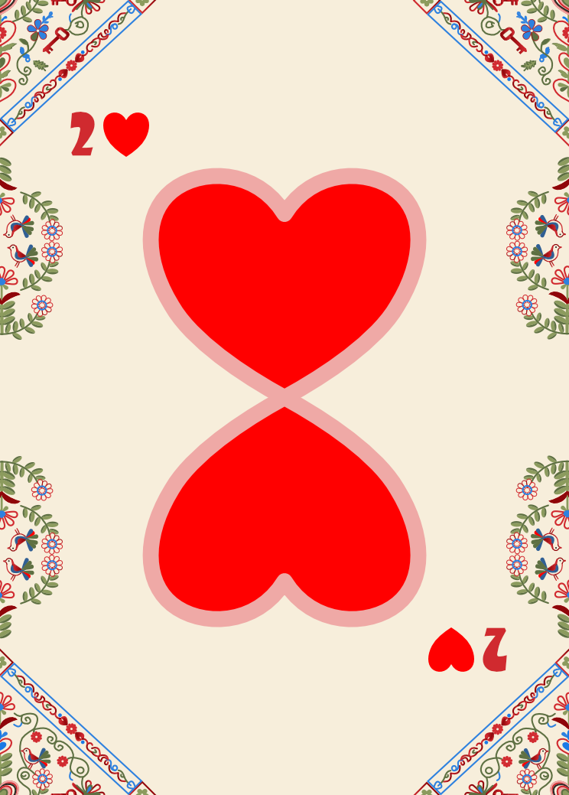
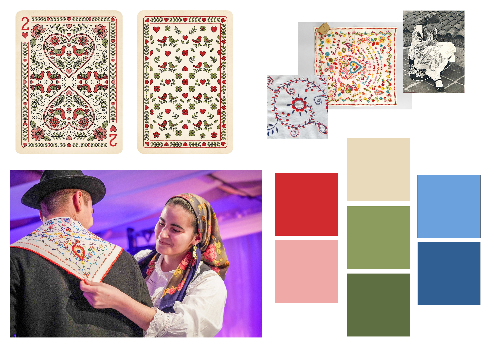
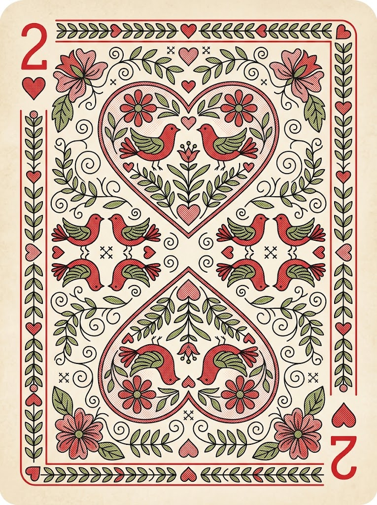
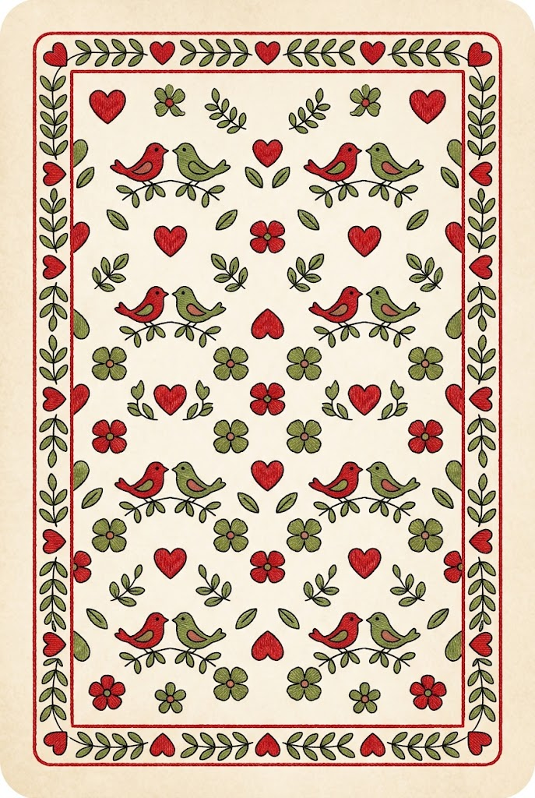

# Two of Hearts - Portuguese Folk Art

A vector illustration project inspired by **Lenços de Namorados**, the traditional love handkerchiefs from the Minho region of Portugal.

This project explores the connection between Portuguese cultural heritage, romantic symbolism and contemporary vector illustration through the design of a playing card.

## 🎴 Project Overview

The chosen card is the **Two of Hearts (2♥)**, symbolizing love, connection and unity.

The front features two stylized birds beneath a central heart, surrounded by floral details inspired by traditional Portuguese embroidery. The back features a continuous decorative pattern that follows the same visual style, creating visual consistency between both sides of the card.

The color palette combines cream, red, pink, green and blue, reflecting the decorative character of traditional folk art.

## 🖼️ Final Design

### Front

### Back

## 🎨 Design Process

### 1. Research and Moodboard

The first phase involved researching visual references and collecting ideas in a moodboard inspired by the colors, symbols and decorative patterns of Lenços de Namorados.

### 2. AI-Generated Concepts

AI image generation was used during the initial exploration phase to develop a visual proposal for the front and back of the card. These images served as references for the final design process.

**Original prompt:**

> 2 of Hearts playing card set, front and back, traditional Portuguese folk art style, Lenços de Namorados, symmetrical vector of two birds kissing, floral embroidery, matching back pattern, cream and red palette

#### AI-generated front

#### AI-generated back

### 3. Vector Illustration

Using the moodboard and the AI-generated concepts as references, I developed my own vector illustration in Affinity.

The final artwork focuses on decorative details, a coordinated color palette and a consistent visual identity across the front and back of the card.

## 🛠️ Tools and Specifications

- **Software:** Affinity
- **Project type:** Vector illustration
- **Card:** Two of Hearts (2♥)
- **Dimensions:** 63 × 88 mm
- **Front:** Two stylized birds, a central heart and floral ornaments
- **Back:** Continuous folk-inspired decorative pattern
- **Color palette:** Cream, red, pink, green and blue
- **Source file:** Editable Affinity document

## 🇵🇹 Cultural Inspiration

Lenços de Namorados are a traditional form of embroidered folk art associated with the Minho region of Portugal. Their hearts, birds, flowers and romantic symbolism provide the cultural inspiration for this project.

By reinterpreting these traditional visual elements in a playing card, this project explores how Portuguese folk art can inspire contemporary graphic design.

## 🎓 Academic Context

**Course:** Software Development - Higher Professional Technical Course (CTeSP), 2nd Year  
**Course Unit:** Authoring Tools (Ferramentas de Autoria)  
**Assignment:** Practical Assignment 1 - Vector Illustration  
**Project brief:** “A Dar Cartas”  
**Software:** Affinity  
**Submission dates:** 27 October 2026 (EST)

---

*An academic project exploring Portuguese folk art, romantic symbolism and vector illustration.*